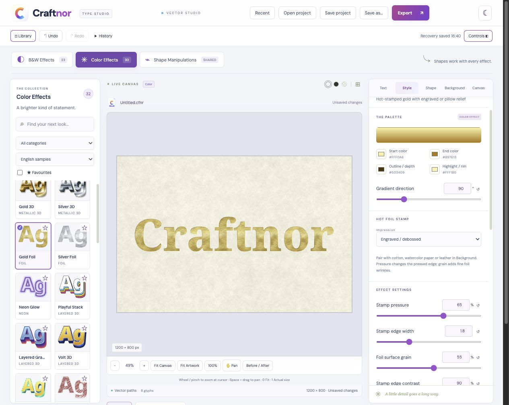

# Craftnor

A browser and cross-platform desktop typography studio by **Appaji Ambarisha Darbha**.
Build styled lettering from Unicode text or imported SVG/EPS outlines, customize
its surface and shape, and export SVG, PNG or JPG.



## Features

- 55 style presets: 23 B&W and 32 Color, including pencil, stencil, speed,
  metallic, 3D, neon, and gold/silver foil finishes.
- Hot-foil impressions: engraved/debossed, pillow/pin-cushion, and raised
  emboss, with pressure, edge lighting and surface-grain controls.
- Paper, cotton, kraft, parchment, watercolor and fine leather backgrounds;
  visual material swatches, grain scale, background image positioning and tint.
- HarfBuzz Unicode shaping, Telugu fonts, uploaded fonts and supported system fonts.
- Shared shape presets and editable deformation controls; shapes start neutral.
- Face, Texture, Outline, Depth and Shadow layer controls.
- Fixed canvas dimensions and presets, cursor-centered zoom, pan, undo/redo,
  history, favourites, Before/After, light/dark themes and responsive panels.
- Editable `.cfnr` projects with embedded font/artwork data, canvas/layer settings,
  background settings, autosave recovery and recent projects.

SVG keeps lettering as outlined paths. Paper/leather and reflective foil material
fills use embedded raster images; these exports are not entirely vector-only.
The hot-stamped appearance is a 2D lighting simulation.

## Run locally

Use **Node.js 24** and npm.

```sh
npm ci
npm run dev
```

Open the local address printed by Vite. To build the web application:

```sh
npm run build
npm exec vite preview
```

The web build is in `dist/`. No server credentials or cloud account are required
for local editing. Browser projects, recipes and recovery data are stored locally.
Local Font Access requires a compatible browser and user permission; font upload
is available as a fallback.

## Desktop

Craftnor uses Electron for macOS, Windows and Linux.

```sh
npm run desktop:dev
npm run desktop:mac
npm run desktop:windows
npm run desktop:linux
```

Build scripts place packages in `../desktop-builds/`. Mac builds cover Apple
Silicon and Intel; the Windows script builds x64 and the Linux script builds
x64/ARM64. To build Windows ARM64, use:

```sh
npm run build
npm exec electron-builder -- --win nsis --arm64 --publish never
```

The GitHub Actions desktop workflow can be run manually and uploads packages as
workflow artifacts. Test builds are unsigned; macOS builds are not notarized.
No automatic updater is configured. Save your project before replacing an app.

## Test

```sh
npm test
npm run desktop:test
npm run build
```

Version 1.3.1 passed 68 application tests and 5 desktop tests, plus browser visual
checks. Cross-built desktop packages still need runtime testing on each target.
See [TESTING.md](TESTING.md) for a manual smoke-test checklist.

## Project and import formats

`.cfnr` is a JSON-based editable Craftnor document with a dedicated extension.
Earlier JSON project files can be imported. Save dialogs and overwrite/quit
warnings are native on desktop; browser capabilities vary.

SVG/EPS import accepts supported filled path geometry. Outline text and strokes
before import. Complex EPS should be converted to SVG. Effects replace original
imported colors. Exports preserve the selected canvas background; editor guides
are excluded.

## Generated materials

Original paper, leather and foil textures are included under `public/textures/`.
To regenerate them, install Python with NumPy and Pillow and run:

```sh
python3 scripts/generate-paper-textures.py
```

## License and credits

Original Craftnor code and assets: **Apache License 2.0**. See [LICENSE](LICENSE)
and [NOTICE](NOTICE). Third-party libraries and bundled fonts retain their own
licenses; see [THIRD_PARTY_NOTICES.md](THIRD_PARTY_NOTICES.md).

Created by **Appaji Ambarisha Darbha**. Additional library/font credits are
available inside the app's About screen.
